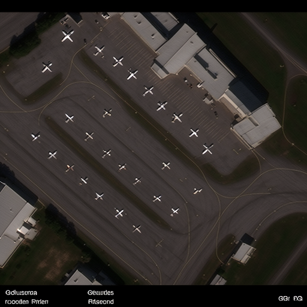

# FLUX.2 LoRA 生成示例

使用仓库中的 [8 张 RarePlanes 示例图片](../../asset/my_data) 训练：rank=4、400 steps。下面展示两个已完成批次，共20张 LoRA 图；每张图都有同名 JSON，记录 prompt、seed 和生成参数。

**路径约定：** JSON 中的文件路径均相对于该 JSON 所在目录；`image` 指向同目录图片，`caption_source_image` 指向仓库中的训练示例。`base_model` 预留到仓库根目录的 `models/FLUX.2-klein-base-4B/`，`adapter_path` 预留到本目录的 `adapter/`，两处权重均未上传。

图片保持原始字节；导出的 JSON 仅调整路径并增加 `path_base`，保留原始 prompt、seed、权重哈希和生成参数。

## 20261012_062704_582709

按训练 caption 循环生成。

P1：`an overhead satellite RGB image of a medium civil transport aircraft at an airport`

P2：`an overhead satellite RGB image of small civil aircraft at an airport`

| 生成图 | Seed | Prompt | 元数据 |
|---|---:|---|---|
|  | 0 | P1 | [JSON](generations/20261012_062704_582709/lora/000000.json) |
|  | 1 | P1 | [JSON](generations/20261012_062704_582709/lora/000001.json) |
|  | 2 | P1 | [JSON](generations/20261012_062704_582709/lora/000002.json) |
|  | 3 | P1 | [JSON](generations/20261012_062704_582709/lora/000003.json) |
|  | 4 | P2 | [JSON](generations/20261012_062704_582709/lora/000004.json) |
|  | 5 | P2 | [JSON](generations/20261012_062704_582709/lora/000005.json) |
|  | 6 | P2 | [JSON](generations/20261012_062704_582709/lora/000006.json) |
|  | 7 | P2 | [JSON](generations/20261012_062704_582709/lora/000007.json) |
|  | 8 | P1 | [JSON](generations/20261012_062704_582709/lora/000008.json) |
|  | 9 | P1 | [JSON](generations/20261012_062704_582709/lora/000009.json) |

## 20261012_063050_103424

指定 prompt 生成。

P1：`an overhead satellite RGB image of a medium civil transport aircraft at an airport`

| 生成图 | Seed | Prompt | 元数据 |
|---|---:|---|---|
|  | 0 | P1 | [JSON](generations/20261012_063050_103424/lora/000000.json) |
|  | 1 | P1 | [JSON](generations/20261012_063050_103424/lora/000001.json) |
|  | 2 | P1 | [JSON](generations/20261012_063050_103424/lora/000002.json) |
|  | 3 | P1 | [JSON](generations/20261012_063050_103424/lora/000003.json) |
|  | 4 | P1 | [JSON](generations/20261012_063050_103424/lora/000004.json) |
|  | 5 | P1 | [JSON](generations/20261012_063050_103424/lora/000005.json) |
|  | 6 | P1 | [JSON](generations/20261012_063050_103424/lora/000006.json) |
|  | 7 | P1 | [JSON](generations/20261012_063050_103424/lora/000007.json) |
|  | 8 | P1 | [JSON](generations/20261012_063050_103424/lora/000008.json) |
|  | 9 | P1 | [JSON](generations/20261012_063050_103424/lora/000009.json) |
